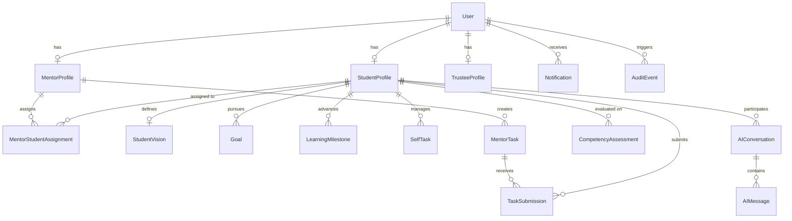

# MENTORA — Implementation Plan
**Vasumathi Ramaswami Centenary Foundation (VRCF)**

---

## 1. Executive Summary & Objective

Mentora is a production-oriented, full-stack student development platform engineered for the Vasumathi Ramaswami Centenary Foundation (VRCF). It empowers college scholars across Tamil Nadu to cultivate leadership, analytical and critical thinking, career readiness, and long-term vision through structured mentor assignments, personalized learning maps, progress tracking, and Socratic AI mentoring powered by Google Gemini.

The initial deployment directly serves 43 existing VRCF scholars, with an architecture designed to scale to hundreds of scholars, mentors, and foundation trustees.

---

## 2. Discovered Assets & Inspection Findings

### 2.1 Logo Asset (`prereq_data/Mentora_Logo.png`)
- **Format:** Portable Network Graphics (PNG)
- **Dimensions:** 225 × 225 pixels
- **Mode:** Palette (`P`) with alpha transparency support
- **Design:** Circular badge featuring the Mentora growth emblem in VRCF brand tones
- **Usage:** Reused across desktop sidebar, mobile header, login view, favicon, and ReportLab PDF headers.

### 2.2 Student Database Workbook (`prereq_data/VRCF Student DB.xlsx`)
- **Active Sheet:** `Form responses 1`
- **Total Rows:** 46 (1 header row, 43 populated student rows, 2 trailing empty rows)
- **Verified Columns (17):**
  1. `Timestamp`: Submission timestamp
  2. `Name`: Full student name
  3. `Cohort`: Cohort 1, 2, or 3
  4. `Home Address`: Residential address
  5. `District`: Home district
  6. `Phone number (self)`: Contact phone
  7. `Phone number parents`: Parent / guardian phone
  8. `Gmail id (self)`: Personal Gmail address
  9. `Course name`: Academic degree and major
  10. `Year of study`: Current college year (e.g. 2nd year, 3rd year, Final year)
  11. `College name and district`: Enrolled institution & campus location
  12. `Total number of academic years`: Degree duration (e.g. 3, 4, 5.5 years)
  13. `Hostel or Dayscholar`: Residence mode
  14. `Tuition fee payment term`: Payment frequency (Per year / Per semester)
  15. `Amount to be paid per year or per semester`: Tuition amount
  16. `Hostel fee (if any)`: Residential / mess charges
  17. `Email address`: Institutional or primary email address

### 2.3 Scholar Identity & Official VRCF ID Resolution
Cross-referencing the foundation's official scholar records reveals the permanent VRCF ID sequence (e.g., `003` to `051`).
- Specific verification: **Suhail Akthar S M** (`suhailmobina95@gmail.com`) is assigned official VRCF ID **`032`** (`VRCF-032`).
- Default credentials policy: Each student account is initialized with default password `vrcf<VRCF_ID_numeric>` (e.g. `vrcf32` for VRCF-032, `vrcf3` for VRCF-003, `vrcf18` for VRCF-018), with mandatory option and setting to update/reset passwords.
- Foundation Administrative Roles:
  - Admin: `admin@gmail.com` / `admin@123`
  - Trustee: `trustee@gmail.com` / `trustee@123`
  - Mentor: `mentor@gmail.com` / `mentor@123`

---

## 3. Technology Stack & System Architecture

### 3.1 Backend & Database
- **Language:** Python 3.11 / 3.12
- **Framework:** Django 5.x
- **Database:** PostgreSQL 16 (Authoritative relational engine in development & production)
  - Connection configured via `DATABASE_URL` with environment overrides
- **Authentication:** Custom Django User model (`core.User`), role-based authorization (`STUDENT`, `MENTOR`, `TRUSTEE`, `ADMIN`)
- **Excel Handling:** `openpyxl`
- **PDF Engine:** `reportlab`
- **AI Mentoring:** Official `google-genai` Python SDK (Gemini Flash candidate)

### 3.2 Frontend & Presentation
- **Markup & Templates:** Semantic HTML5, Django Template Engine with reusable partials
- **Styling:** Custom CSS3 design tokens + Bootstrap 5.3 + Bootstrap Icons
- **Visual Palette:** Refined Teal (`#0d9488`, `#0f766e`, `#115e59`) with neutral slates and warm whites
- **Themes:** First-class Light & Dark themes persisted in localStorage and session cookies
- **Data Visualizations:** Chart.js (Radar, Bar, Line charts) reading strictly from PostgreSQL endpoints
- **PWA:** Web App Manifest (`manifest.json`) and Service Worker (`sw.js`) for installable mobile experience

---

## 4. Database Schema Specification

### 4.1 Ten Core Competencies
1. Critical Thinking
2. Analytical Thinking
3. Logical Reasoning
4. Problem Solving
5. Innovative Thinking
6. Communication
7. Leadership
8. Digital/AI Literacy
9. Career Readiness
10. Domain / Academic Competency

---

## 5. URL Routes & Role Namespaces

- **Authentication:**
  - `/auth/login/` (Username/Email + Password, Remember Me)
  - `/auth/logout/`
  - `/auth/password-reset/`
  - `/auth/profile-password-change/`
- **Student Namespace (`/student/`):**
  - `/student/dashboard/`
  - `/student/profile/`
  - `/student/vision/`
  - `/student/learning-map/`
  - `/student/tasks/`
  - `/student/tasks/<id>/submit/`
  - `/student/tasks/self/create/`
  - `/student/tasks/self/<id>/toggle/`
  - `/student/ai-mentor/`
  - `/student/ai-mentor/chat/`
  - `/student/ai-mentor/history/`
  - `/student/progress/`
  - `/student/resources/`
  - `/student/notifications/`
- **Mentor Namespace (`/mentor/`):**
  - `/mentor/dashboard/`
  - `/mentor/students/`
  - `/mentor/students/<id>/`
  - `/mentor/tasks/`
  - `/mentor/tasks/assign/`
  - `/mentor/submissions/`
  - `/mentor/submissions/<id>/review/`
  - `/mentor/reports/`
  - `/mentor/reports/<student_id>/pdf/`
  - `/mentor/support-alerts/`
- **Trustee Namespace (`/trustee/`):**
  - `/trustee/dashboard/`
  - `/trustee/students/`
  - `/trustee/students/<id>/`
  - `/trustee/feedback/send/`
  - `/trustee/mentors/`
  - `/trustee/analytics/`
  - `/trustee/analytics/data/`
- **Administrative & Utility:**
  - `/admin-tools/import/` (Excel import preview & execute)
  - `/admin-tools/students/add/`
  - `/healthz/` (Health check)

---

## 6. Implementation Milestones

1. **Phase 1: Foundation & PostgreSQL Setup**
   - Initialize Django project `mentora`
   - Configure PostgreSQL settings with `dj-database-url`
   - Custom User model, Profiles, Roles, and core models
   - Initial migrations
2. **Phase 2: Data Import & Management Command**
   - `python manage.py import_students` reading `prereq_data/VRCF Student DB.xlsx`
   - Verification of 43 real scholars with VRCF IDs & account provisioning
   - Generation of `IMPORT_REPORT.md`
3. **Phase 3: Design System & Shared Layouts**
   - Custom CSS3 with light/dark theme toggle
   - Mobile responsive drawer and collapsible sidebar
   - Reusable template components (cards, badges, modals, toasts, empty states)
4. **Phase 4: Authentication & Role Redirects**
   - Login page supporting username or email
   - Remember Me session cookie handling
   - Role-based server-side routing
5. **Phase 5: Student Experience**
   - Profile view & update
   - Vision & Goals workspace
   - Interactive Learning Map
   - Tasks & Submissions workflow
   - Progress Analytics & Competency radar
   - Personalized Resource directory
6. **Phase 6: Mentor Experience**
   - Student roster with search & filters
   - Task assignment modal/page
   - Submission review & rubrics
   - ReportLab PDF Growth Report generation
   - Early support alerts
7. **Phase 7: Trustee Experience**
   - Program-wide real database aggregate metrics
   - Scholar profiles & personalized feedback dispatch
   - Mentor program oversight
   - Chart.js analytics endpoints
8. **Phase 8: AI Socratic Mentor**
   - Google GenAI SDK integration with Gemini Flash
   - Structured context assembly (goals, competencies, history)
   - Socratic interaction prompts & activity generator
   - Rate limiting, error handling, token accounting
9. **Phase 9: Quality Assurance & Deployment**
   - Automated tests (Auth, Permissions, Transactions, PDF, AI fallbacks)
   - Git commits and push to `https://github.com/24f2002684/mentora-v3.git`
